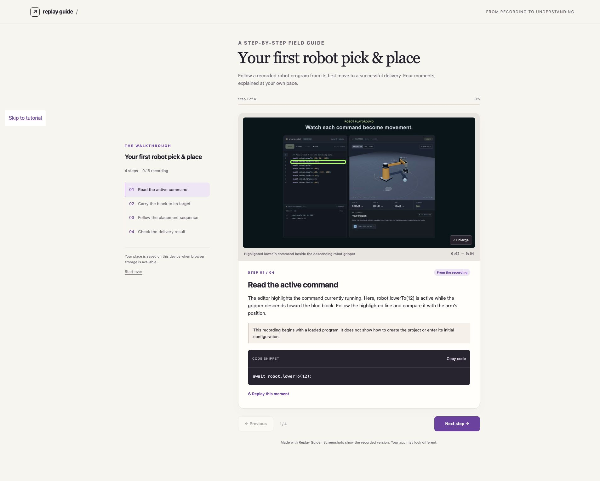

# Replay Guide

**Turn a screen recording into a tutorial people can follow at their own pace.**

An open-source AI skill with a local media helper and a portable HTML reader. Give your coding agent a recording; it inspects the workflow, writes illustrated steps, flags uncertain actions, and builds a guide that adapts to phones and desktops.

[Try the example](https://niceskipperchen-coder.github.io/replay-guide/) · [Skill instructions](skills/replay-guide/SKILL.md) · [Tutorial format](skills/replay-guide/references/tutorial-format.md)



## What you get

- One step at a time, with an outline and reading progress.
- Embedded screenshots, optional highlights and an enlargement view for small UI text.
- Copyable code and optional timestamped video replay.
- A responsive phone layout with large navigation controls.
- Visible review flags when the recording leaves something unclear.

The AI agent does the interpretation. The Python helper extracts frames and renders the agent-authored JSON; it does not recognize clicks, transcribe speech, or generate steps on its own. Creating a guide requires a computer. Reading the result works in a modern mobile browser.

## Install the skill

Clone this repository and copy `skills/replay-guide` into the skill directory your agent uses. For example:

```sh
git clone https://github.com/niceskipperchen-coder/replay-guide.git
mkdir -p ~/.codex/skills
cp -R replay-guide/skills/replay-guide ~/.codex/skills/
```

For Claude Code, copy the same folder into `~/.claude/skills/`. These are ordinary skill files; discovery paths, media understanding and available tools depend on your agent. They are not a standalone phone app.

Then ask your agent:

> Use replay-guide to turn this recording into an interactive tutorial for a beginner. Keep uncertain steps marked for review, and make the result work on a phone.

## Local helper

Requires **Python 3.10+**. Media preparation and optional video validation also require **FFmpeg and ffprobe** on PATH. No pip packages, API keys or network calls are used by the helper. Your AI agent may have its own subscription or usage costs.

From this repository:

```sh
# Extract 12 timestamped frames and audio if present.
python3 skills/replay-guide/scripts/replay_guide.py prepare recording.mp4 \
  --out /tmp/replay-evidence --frames 12 --audio

# The agent inspects the frames and authors tutorial.json in that directory.
# See the documented format and worked example; preparation does not create steps.

# Build a self-contained HTML file with embedded screenshots.
python3 skills/replay-guide/scripts/replay_guide.py build /tmp/replay-evidence/tutorial.json \
  --out /tmp/replay-tutorial

# Optional: include the original H.264 MP4 beside HTML for replay.
python3 skills/replay-guide/scripts/replay_guide.py build /tmp/replay-evidence/tutorial.json \
  --out /tmp/replay-with-video --video recording.mp4
```

Open the generated `index.html`. When video is included, share the whole output folder together. For GitHub Pages, publish that folder as the site root. Embedded screenshots make image-only HTML portable without a server; browser storage/clipboard support may vary when opening local files.

Inputs are limited to 30-minute recordings and 48 frames/steps per run. Output folders must be new to prevent accidental overwrites. Failed decoding may leave partial extraction output; retry in a new folder. The v1 JSON format accepts PNG/JPEG/WebP screenshots and plain text; no rich HTML or executable actions.

## Example

[`examples/robot-playground/tutorial.json`](examples/robot-playground/tutorial.json) explains four moments in a real Robot Playground recording. The rendered guide is in [`demo/`](demo/). One placement-timing step is deliberately marked **Needs review** because sampled screenshots alone do not establish the exact release instant. It demonstrates honest draft output, not a claim that every instruction was independently replayed.

```sh
python3 skills/replay-guide/scripts/replay_guide.py build \
  examples/robot-playground/tutorial.json --out /tmp/replay-example
```

The screenshots show an earlier Robot Playground version. The included recording is the author's existing public project demo; it contains no private user footage.

## Privacy

Screenshots, narration and the optional original video can include private information. Inspect and sanitize them before sharing. The helper keeps processing local and has no telemetry. Invoking the skill inside a cloud AI agent may expose input to that provider under its own settings. The skill does not automatically publish a guide or upload media to an additional service.

## Development

```sh
python3 -m unittest discover -s tests -v
```

The integration test generates a synthetic MP4 with FFmpeg. See [validation notes](docs/validation.md) for browser checks and limits. [Contributions](CONTRIBUTING.md) are welcome, especially small sanitized recordings with clear expected steps and mobile/browser fixes.

MIT licensed · Built by [Skipper Chen](https://github.com/niceskipperchen-coder)
